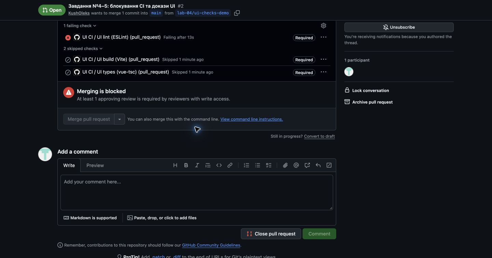
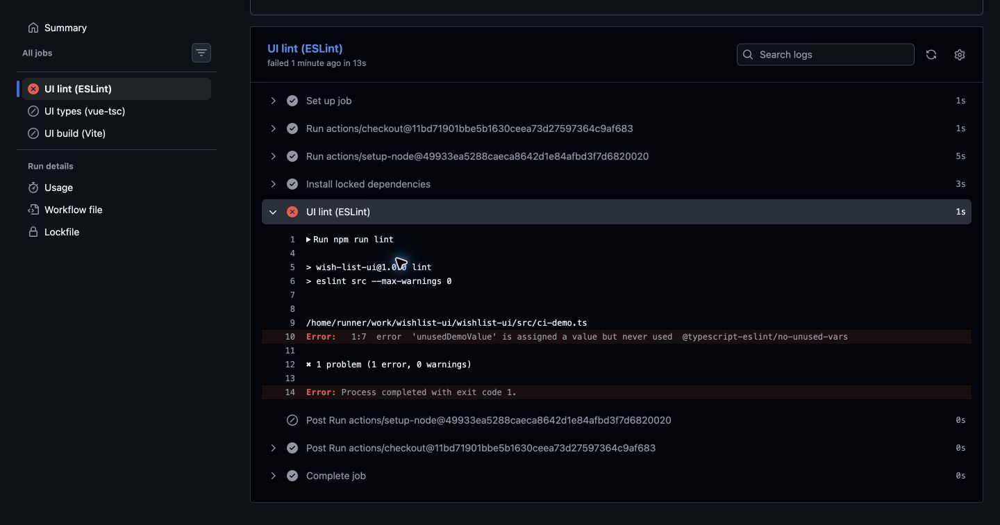
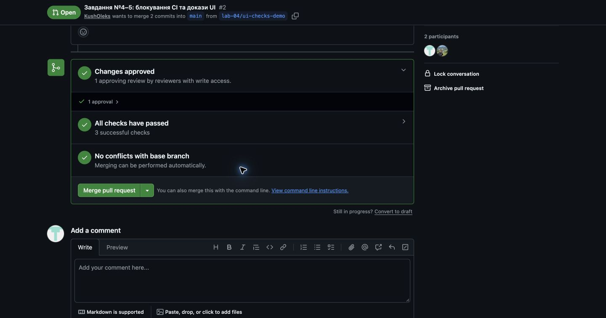

# Завдання №3 — CI для UI

Workflow `.github/workflows/ci.yml` запускається на pull_request і push у main. Це перевірка фронтенду: API, PostgreSQL і Redis для неї не потрібні.

## Послідовність

1. **UI lint (ESLint)** — `npm run lint`: перевірка src/**/*.ts, src/**/*.vue та JavaScript. ESLint використовує рекомендовані правила JavaScript і TypeScript та essential-правила Vue. Жодних warnings не допускається. Для наявних однослівних назв Login/Register/Welcome/Wishlists задано явні винятки лише з правила імен компонентів.
2. **UI types (vue-tsc)** — `npm run typecheck` перевіряє TypeScript і Vue SFC. Запускається після lint.
3. **UI build (Vite)** — `npm run build` створює dist; цей наявний скрипт також повторно перевіряє типи. Запускається після typecheck. Папка dist завантажується як артефакт **wishlist-ui-dist**, строк зберігання — 14 днів. Відсутність dist є помилкою.

Усі job використовують Ubuntu 24.04, Node.js 24.21.0 із .nvmrc, `npm ci` та кеш npm через setup-node з ключем за package-lock.json. Самі node_modules не кешуються. Версії checkout v4.2.2, setup-node v4.4.0 та upload-artifact v4.6.2 закріплені точними SHA. Дозволи workflow — contents: read.

Для проходження ESLint прибрано невикористані catch-змінні та замінено явні any на типізовані дані відповіді й unknown з перевіркою Axios-помилки. Виправлення не вимикають перевірку no-explicit-any. Валідаційні відповіді без текстового detail показують резервне повідомлення.

## Повторення локально

```bash
nvm install
nvm use
npm ci
npm run lint
npm run typecheck
npm run build
```

Node.js має відповідати .nvmrc. Збірка не потребує запущеного API. VITE_API_BASE задається під час збірки; без нього діє адреса localhost:8000, передбачена src/api.ts. Артефакт — готова статична збірка, це не автоматичне розгортання сайту.

## Перевірка

Локально lint, typecheck та build пройшли. [UI CI у PR №1](https://github.com/KushOleks/wishlist-ui/actions/runs/42913704389) успішний: усі три job зелені. Артефакт wishlist-ui-dist (59556 байт) завантажено та перевірено: містить index.html, assets/*.js і assets/*.css. [Pull Request](https://github.com/KushOleks/wishlist-ui/pull/1).

Тести UI не додано відповідно до умови. Rulesets, демонстрація блокування merge та вимірювання часу кешу належать до завдань №4–5 і тут не виконуються.

## Завдання №4 — обов’язкові перевірки main

Активний ruleset вимагає Pull Request, одне схвалення з Write-доступом, успішні перевірки GitHub Actions і актуальність гілки щодо main. Нові коміти скидають застарілі схвалення. Force-push і видалення main заборонені. Список bypass порожній: власник також має дотримуватися правил.

Обов’язкові статуси: `UI lint (ESLint)`, `UI types (vue-tsc)`, `UI build (Vite)`.

[Демонстраційний PR №2](https://github.com/KushOleks/wishlist-ui/pull/2) спочатку містив безпечну помилку лінту в окремому файлі. Помилковий файл видалено в цьому самому PR; робочий код застосунку не змінюється.

### 1. Червона обов’язкова перевірка й блокування злиття



На скриншоті видно failing check із позначкою Required та Merging is blocked. На цьому етапі також відсутнє обов’язкове схвалення; після виправлення виконуються обидві умови.

### 2. Конкретна помилка в журналі CI



[ESLint @typescript-eslint/no-unused-vars: unusedDemoValue у src/ci-demo.ts:1:7](https://github.com/KushOleks/wishlist-ui/actions/runs/43745712599). Наступні job пропущені через залежність від lint.

### 3. Той самий PR після виправлення



Зелений стан і схвалення фіксуються перед злиттям; скриншот буде додано після фактичної перевірки.

## Завдання №5 — фактичний ефект кешу

| Прогін | Час | GitHub Actions |
|---|---:|---|
| Без кешу на початку першого прогону | 57 с | [прогін 42913704389](https://github.com/KushOleks/wishlist-ui/actions/runs/42913704389) |
| З кешем, наступний прогін | 53 с | [прогін 42913982503](https://github.com/KushOleks/wishlist-ui/actions/runs/42913982503) |

Найдовший крок — setup-node у job UI types: 6 с у першому прогоні та 7 с у теплому (у першому ще один setup-node мав ті самі 6 с).

Різниця — 4 с (7.0%). Час отримано з GitHub API run_duration_ms; тривалості кроків — із started_at/completed_at jobs. Обидва прогони мають однаковий lockfile і ключ кешу. У першому lint мав cache miss та зберіг кеш; наступні job цього ж прогону вже могли його використовувати. У наступному прогоні всі job відновили той самий кеш. Тому це порівняння холодного старту workflow з теплим, а не повністю вимкненого кешування в усіх job. Час також залежить від підготовки runner і сервісів.
