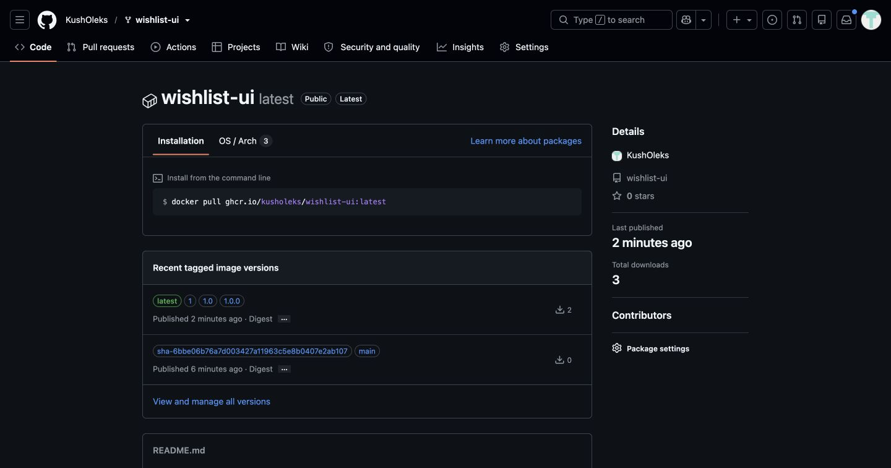

# Лабораторна №5 — образ UI

Dockerfile має етап `build`: Node 24.21.0-alpine, npm ci за package-lock.json,
потім копіювання коду й збірка Vite. ARG VITE_API_BASE є обов’язковим.
Фінальний production етап — nginx 1.28.0-alpine, nginx.conf і dist.
Node, node_modules, вихідний TypeScript, .env і Git у фінальний образ не копіюються.
nginx try_files повертає index.html для SPA-маршрутів, /health повертає 200.

```bash
docker build --target build --build-arg VITE_API_BASE=http://localhost:8000 -t wishlist-ui:build .
docker build --build-arg VITE_API_BASE=http://localhost:8000 -t wishlist-ui:lab05-local .
docker image inspect wishlist-ui:build wishlist-ui:lab05-local --format '{{.RepoTags}} {{.Size}}'
```

## Розміри

Виміряно на Mac M1, linux/arm64 через docker image inspect (Size, байти):

| Образ | Розмір, байти | MiB |
|---|---:|---:|
| build (`--target build`) | 327303019 | 312,14 |
| production | 49993633 | 47,68 |

Найбільший виміряний каталог build-етапу — `/app/node_modules`: 153,8 MiB;
`/usr/local` (Node та інструменти) — 147,3 MiB, `dist` — 172 KiB.
Фінальний образ не має Node та node_modules; перевірка дала `lean-runtime-ok`.
Вимірювання стосуються локальних arm64 образів, а не стисненого розміру GHCR.

## Адреса API

Vite вбудовує VITE_API_BASE у JavaScript під час npm run build.
Runtime environment nginx не переписує вже створені статичні файли.
Для зміни адреси потрібна повторна збірка з новим build-arg; секрети таким способом не передаються.
Адреса призначена браузеру: localhost:8000, а не внутрішнє ім’я api:8000.

## Стек та розробка

[Повна інструкція Compose](https://github.com/KushOleks/withlist-api/blob/main/docs/containers.md).
Обидва репозиторії клонуються в сусідні папки. compose.yaml лежить у withlist-api.
Dev-профіль використовує bind mount джерел і named volume node_modules; npm ci при старті
оновлює Linux-залежності з lock-файлу. Vite відображає зміни компонентів без Docker build.

## CI та реєстр

UI image (Docker) запускається після lint, types і Vite build.
На PR виконується тільки збірка та перевірка nginx/SPA; публікація заборонена.
Main публікує main та sha-<повний SHA>, v* — semver теги й latest.
Публікація multi-arch: linux/amd64 та linux/arm64, GHCR login через GITHUB_TOKEN.
Trivy — окремий advisory job; він зберігає JSON і підсумок OS/application findings у Summary.
[Реліз v1.0.0](https://github.com/KushOleks/wishlist-ui/releases/tag/v1.0.0) опубліковано.
[Публічний пакет GHCR](https://github.com/KushOleks/wishlist-ui/pkgs/container/wishlist-ui)
має теги main, sha-<коміт>, 1.0.0, 1.0, 1 та latest.



[Повний imagetools inspect](containers-assets/release-manifest.txt) підтверджує
linux/amd64 і linux/arm64 під тегом 1.0.0. `unknown/unknown` записи — attestations,
а не додаткові архітектури. Digest індексу:
`sha256:f10655cff01b446aebac6a2efdd1ab53777ee98f2f884fb2aa893104e0f313c1`.

[Лог анонімного docker pull](containers-assets/anonymous-pull.txt): використано
порожній DOCKER_CONFIG без auth, образ завантажився без docker login.
[Зелений релізний CI](https://github.com/KushOleks/wishlist-ui/actions/runs/45496937038).


## Trivy — контрольний PR-прогін

[UI CI 45494718518](https://github.com/KushOleks/wishlist-ui/actions/runs/45494718518)
містить артефакт wishlist-ui-trivy. У JSON — 198 записів OS-пакетів і 0 бібліотек застосунку.
Більшість знахідок походить із базового nginx/Alpine образу. Node-залежності не входять
до production-образу; відсутність їх у звіті образу не означає відсутності проблем npm,
для них лишається окремий dependency audit з лабораторної №4.
